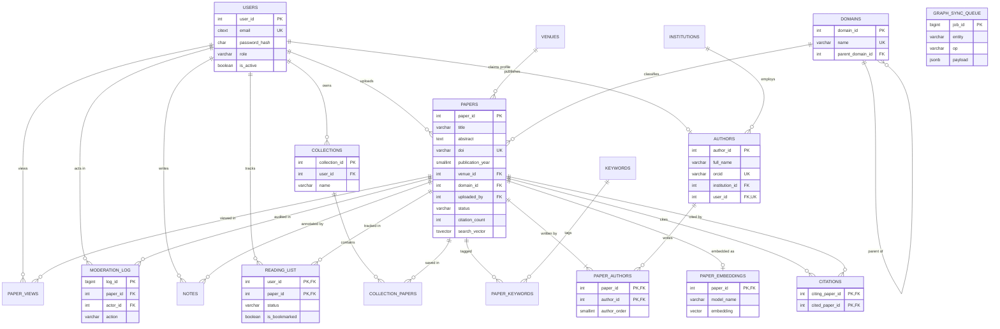

# ER Diagram and Relational Schema

PostgreSQL is the system of record. The schema has 18 tables in Third Normal Form (3NF).
Many-to-many relationships are resolved with junction tables. The only deliberate
denormalization is `papers.citation_count`, kept correct by a trigger.

The diagram below renders on GitHub (Mermaid, crow's-foot notation). For the report, redraw
it in Chen notation in draw.io and export it as `docs/diagrams/er-diagram.png`.

`GRAPH_SYNC_QUEUE` has no foreign keys on purpose: it is an outbox that still has to describe
papers after they are deleted, so the Neo4j copy can be cleaned up.

## Entities, relationships and cardinality

| Relationship | Type | How it is implemented |
| --- | --- | --- |
| User claims an author profile | 1 : 0..1 | `authors.user_id` FK with `UNIQUE` |
| User uploads papers | 1 : N | `papers.uploaded_by` FK, `ON DELETE SET NULL` (papers outlive accounts) |
| Institution employs authors | 1 : N | `authors.institution_id` FK |
| Venue publishes papers | 1 : N | `papers.venue_id` FK |
| Domain classifies papers | 1 : N | `papers.domain_id` FK, `ON DELETE RESTRICT` |
| Domain hierarchy (AI → NLP) | Recursive 1 : N | `domains.parent_domain_id` FK to `domains` |
| Papers ↔ authors | M : N | Junction `paper_authors` with `author_order` |
| Papers ↔ keywords | M : N | Junction `paper_keywords` |
| Paper cites paper | Recursive M : N | Junction `citations` (citing, cited) |
| Paper has an embedding | 1 : 0..1 | `paper_embeddings.paper_id` is both PK and FK (weak entity) |
| Collection contains papers | M : N | Junction `collection_papers` |
| User tracks reading status | M : N with attributes | `reading_list` (status, bookmark) |
| User writes notes on papers | Ternary-like 1 : N | `notes` with FKs to both |

## Relational schema

Underlined = primary key, `→` = foreign key.

- **users** (<u>user_id</u>, full_name, email, password_hash, role, is_active, created_at, last_login_at)
- **institutions** (<u>institution_id</u>, name, country_code, openalex_id)
- **venues** (<u>venue_id</u>, name, venue_type, publisher, openalex_id)
- **domains** (<u>domain_id</u>, name, description, parent_domain_id → domains)
- **authors** (<u>author_id</u>, full_name, orcid, openalex_id, institution_id → institutions, user_id → users, created_at)
- **papers** (<u>paper_id</u>, title, abstract, doi, openalex_id, publication_year, venue_id → venues, domain_id → domains, uploaded_by → users, status, pdf_path, citation_count, external_citation_count, search_vector, created_at, updated_at)
- **paper_authors** (<u>paper_id → papers, author_id → authors</u>, author_order)
- **keywords** (<u>keyword_id</u>, term)
- **paper_keywords** (<u>paper_id → papers, keyword_id → keywords</u>)
- **citations** (<u>citing_paper_id → papers, cited_paper_id → papers</u>, created_at)
- **paper_embeddings** (<u>paper_id → papers</u>, model_name, embedding, source_text_hash, embedded_at)
- **collections** (<u>collection_id</u>, user_id → users, name, description, is_public, created_at)
- **collection_papers** (<u>collection_id → collections, paper_id → papers</u>, added_at)
- **reading_list** (<u>user_id → users, paper_id → papers</u>, status, is_bookmarked, updated_at)
- **notes** (<u>note_id</u>, user_id → users, paper_id → papers, body, created_at, updated_at)
- **moderation_log** (<u>log_id</u>, paper_id → papers, paper_title, actor_id → users, action, old_status, new_status, reason, created_at)
- **paper_views** (<u>view_id</u>, paper_id → papers, user_id → users, viewed_at)
- **graph_sync_queue** (<u>job_id</u>, entity, op, payload, created_at, processed_at, attempts, last_error)

## Normalization notes

- **1NF:** every column is atomic. Authors and keywords are rows in their own tables, never
  comma-separated strings inside `papers`.
- **2NF:** junction tables have composite keys and carry only attributes that depend on the
  whole key (`author_order` depends on both paper and author).
- **3NF:** no transitive dependencies. Venue names live in `venues`, not repeated on every
  paper; an author's institution lives in `institutions`.
- **Controlled denormalization:** `papers.citation_count` could be computed with
  `COUNT(*)` over `citations`, but search sorts by it on every request, so a trigger keeps
  a stored copy in sync.
