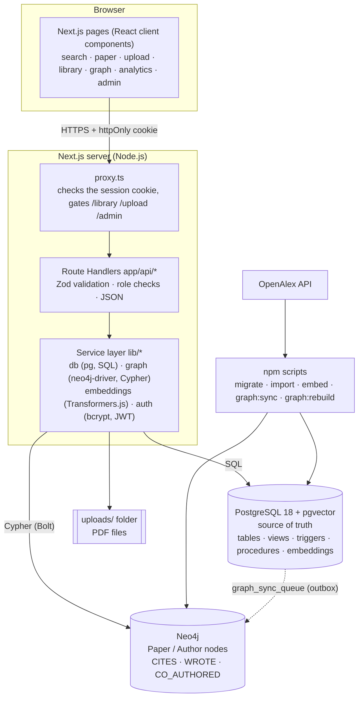

# System Architecture

One Next.js project serves both the pages and the API. Pages run in the browser and call
Route Handlers under `app/api/*`; only server-side code talks to the databases.



## Layers

| Layer | Location | Responsibility |
| --- | --- | --- |
| Pages | `app/**/page.tsx`, `components/` | UI only; call the API with `apiFetch` |
| Route guard | `proxy.ts` | Redirect guests and non-admins before protected pages render |
| API | `app/api/**/route.ts` | Parse and validate input (Zod), check the role again, call the service layer, return JSON |
| Error mapping | `lib/api/http.ts` | Turns Zod errors and PostgreSQL constraint violations (23505, 23514, ...) into 400/409 JSON errors |
| Data access | `lib/db/queries/*.ts` | All SQL, parameterized (`$1`, `$2`) |
| Graph access | `lib/graph/*.ts` | All Cypher, sync and rebuild |
| Embeddings | `lib/embeddings/*.ts` | Local MiniLM model |
| Database | `db/migrations/*.sql` | Schema, constraints, triggers, views, procedures |

## Request flow: upload, approval and search

```mermaid
sequenceDiagram
    actor R as Researcher
    actor A as Admin
    participant API as Next.js API
    participant PG as PostgreSQL
    participant N as Neo4j

    R->>API: POST /api/papers (form + PDF)
    API->>API: Zod validation, PDF signature check, save file
    API->>PG: BEGIN; CALL sp_add_paper(...); UPDATE pdf metadata; COMMIT
    PG-->>PG: trigger: moderation_log 'submit'
    A->>API: POST /api/admin/papers/:id/review (approve)
    API->>PG: BEGIN; SELECT ... FOR UPDATE; SET LOCAL actor/reason; UPDATE status; COMMIT
    PG-->>PG: triggers: moderation_log 'approve' + graph_sync_queue jobs
    API->>API: embed title + abstract (MiniLM)
    API->>PG: UPSERT paper_embeddings; fn_refresh_analytics()
    API->>PG: SELECT jobs FOR UPDATE SKIP LOCKED
    API->>N: MERGE Paper, WROTE, CITES, CO_AUTHORED
    R->>API: GET /api/search?q=...&mode=hybrid
    API->>PG: full-text rank + HNSW vector rank, fused with RRF
```

## Security measures

| Measure | Where |
| --- | --- |
| Passwords stored only as bcrypt hashes (cost 12); a CHECK constraint rejects anything else | `lib/auth/password.ts`, `002_users.sql` |
| Session = signed JWT in an httpOnly, SameSite=Lax cookie (Secure in production), 8-hour expiry | `lib/auth/token.ts`, `lib/auth/session.ts` |
| Role and active flag re-read from the database on every API call | `getCurrentUser()` |
| Role checks in `proxy.ts` and in every protected route | `requireUser()`, `requireRole("admin")` |
| Login throttling: 5 failures per email and address per 15 minutes; constant-time response for unknown emails | `lib/auth/rate-limit.ts`, login route |
| All SQL parameterized; ILIKE input escaped | `lib/db/queries/*` |
| App connects as `app_user` (DML only); migrations use the owner role | `003_app_privileges.sql`, `.env` |
| Credentials only in `.env` (gitignored); `.env.example` has placeholders | repository |
| Upload checks: PDF magic bytes, size limit, random file name, path-traversal guard, SHA-256 stored | `lib/storage/pdf.ts` |
| Search snippets rendered without `dangerouslySetInnerHTML` | `components/highlight.tsx` |
| Security headers: nosniff, frame DENY, referrer policy, permissions policy, no X-Powered-By | `next.config.ts` |

## Technology versions

| Component | Version |
| --- | --- |
| Node.js | 26 LTS (22.12+ works) |
| Next.js / React | 16.4 / 19.3 |
| PostgreSQL | 18 (Docker image `pgvector/pgvector:pg18`) |
| pgvector | 0.8.x (bundled in the image) |
| Neo4j | 2026.07 Community (Docker image `neo4j:2026.07.1`) |
| Embedding model | `Xenova/all-MiniLM-L6-v2`, 384 dimensions |
